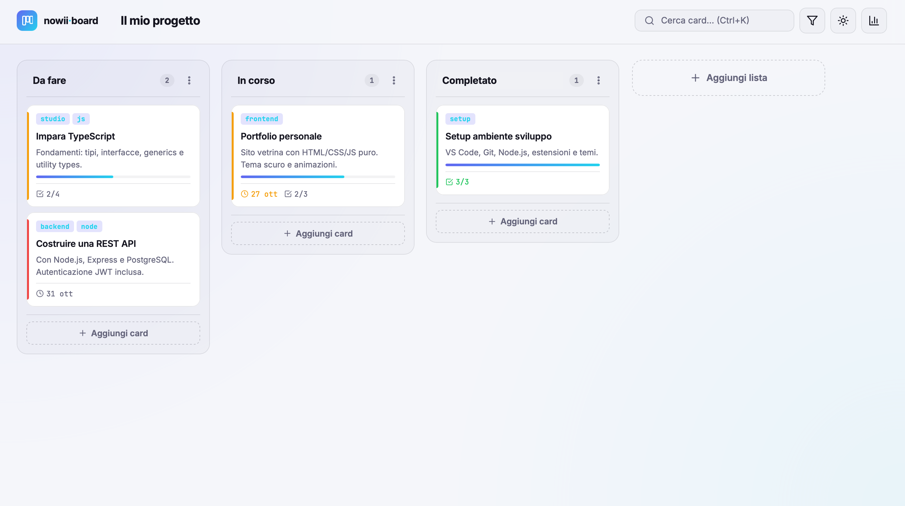

# Kanban Board

<p align="center">
  <b>Trello-Style Kanban Board Application with Fluid Drag-and-Drop, Card CRUD Operations, Live Search Filtering, and Local Persistence</b>
</p>

<p align="center">
  <a href="https://github.com/nowii-core/Kanban-Board-/actions/workflows/ci.yml">
    
  </a>
  <a href="https://github.com/nowii-core/Kanban-Board-/blob/main/LICENSE">
    
  </a>
  
  
  
</p>

<p align="center">
  <a href="#-overview">Overview</a> •
  <a href="#-key-features">Features</a> •
  <a href="#-project-architecture">Architecture</a> •
  <a href="#-tech-stack">Tech Stack</a> •
  <a href="#-quick-start">Quick Start</a> •
  <a href="#-testing">Testing</a> •
  <a href="#-contact">Contact</a>
</p>

---

</div>

## Overview

**Kanban Board** is a modern, lightweight web application designed for visual task management and productivity. Developed following the principles of *Clean Code* and a zero-dependency architecture, it provides a seamless Trello-like experience right in the browser. It features fluid drag-and-drop mechanics, complete card CRUD operations, real-time search filtering, and data persistence powered natively by the browser's LocalStorage.

---

## Preview



>  **Live Demo:** [nowii-core.github.io/Kanban-Board-/kanban-board/](https://nowii-core.github.io/Kanban-Board-/kanban-board/)

---

## Key Features

- **Fluid Drag-and-Drop:** Intuitive and smooth card movement across different columns to organize workflows efficiently.
- **Card CRUD Operations:** Fully functional Create, Read, Update, and Delete operations for managing tasks and details.
- **Live Search Filtering:** Instant, real-time filtering to quickly locate specific tasks within the board.
- **Local Persistence:** Automatic data saving and restoration via LocalStorage, ensuring your board remains intact after page reloads.
- **Zero External Dependencies:** Built entirely with Vanilla JavaScript, HTML5, and CSS3, eliminating the need for heavy frameworks or external libraries.
- **Responsive & Clean UI:** A distraction-free interface designed to adapt seamlessly across desktop and mobile devices.

---

## Tech Stack

### Frontend
- **HTML5:** Semantic markup structure compliant with modern web standards.
- **CSS3:** Modular styling for layout, animations, and responsive design.
- **JavaScript (ES6+):** Native DOM manipulation and application logic without the overhead of third-party frameworks.

### Storage
- **Web Storage API (LocalStorage):** Client-side persistent storage for tasks, columns, and board state.

---

## Project Architecture

```
Kanban-Board-/
├── .github/                 # Issue/PR templates and CI/CD workflows
├── kanban-board/            # Core application source files
│   ├── assets/              # Icons, graphics, and static resources
│   ├── css/                 # Modular stylesheets
│   └── js/                  # Application logic and DOM manipulation
├── Screenshot-1.png         # Application preview image
├── README.md                # Project documentation
└── index.html               # Main entry point of the application
```

---

## Quick Start

### Prerequisites
- A modern web browser (Chrome, Firefox, Safari, Edge).
- No local server or build tools are strictly required, but using one is recommended for development.

### Installation

1. **Clone the repository:**
   ```bash
   git clone https://github.com/nowii-core/Kanban-Board-.git
   cd Kanban-Board-
   ```

2. **Run the application:**
   Simply open the `index.html` file in your preferred web browser, or use a local development server (e.g., VS Code Live Server extension) to view the application.

---

## Testing

Since the application relies on native browser APIs, manual testing can be performed by interacting directly with the UI (creating, moving, and deleting cards).

For automated testing, you can verify the application logic by running your preferred test runner (if configured).

```bash
# Example command to run tests (if a package manager is added later)
npm test
```

---

## License

This project is distributed under the **MIT** license. See the [`LICENSE`](./LICENSE) file for more information.

---

## Contact & Support

- **Maintainer:** [@nowii-core](https://github.com/nowii-core)
- **Bug Reports & Feature Requests:** If you encounter an issue or would like to suggest an improvement, open an [Issue](https://github.com/nowii-core/Kanban-Board-/issues) or submit a [Pull Request](https://github.com/nowii-core/Kanban-Board-/pulls).

---

<div align="center">
  <sub>Developed by <b>nowii-core</b></sub>
</div>
